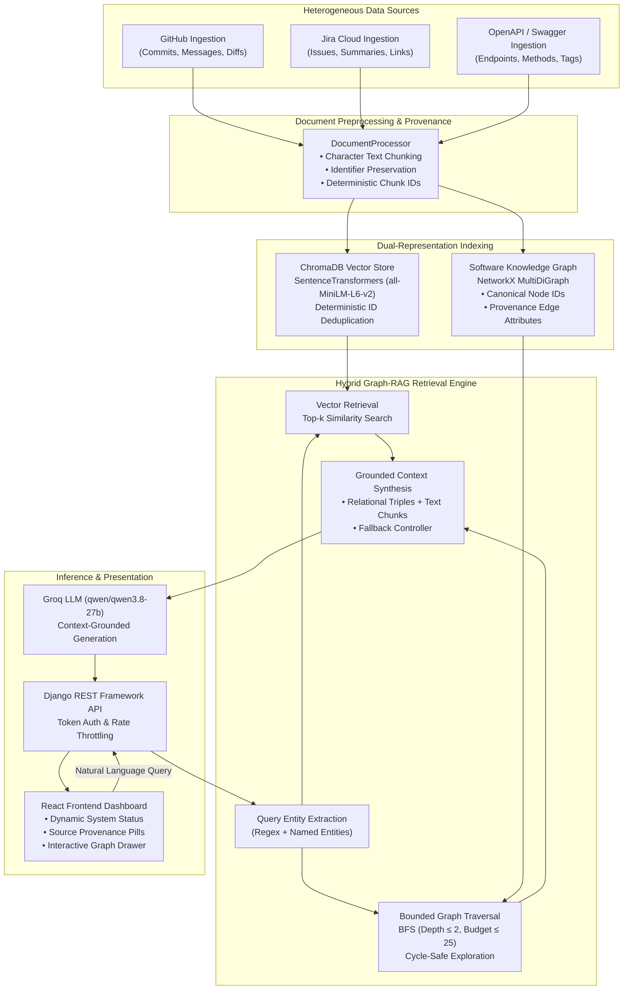

# Context-Aware Cross-Platform Software Intelligence Assistant: A Hybrid Graph-RAG Framework for Unified Software Engineering Knowledge

[](https://icitiit.org/)
[](https://www.python.org/)
[](https://www.djangoproject.com/)
[](https://reactjs.org/)
[](https://www.trychroma.com/)
[](https://networkx.org/)
[](https://groq.com/)
[](LICENSE)

---

## 1. Abstract & Research Context

Modern software engineering organizations operate in highly fragmented multi-tool ecosystems where source code resides in Git/GitHub repositories, project requirements and defects are tracked in Atlassian Jira, and service contracts are documented using OpenAPI/Swagger specifications. Standard text-matching and vector-only Retrieval-Augmented Generation (RAG) approaches frequently fail on cross-platform engineering inquiries because vector proximity cannot preserve structural, multi-hop semantic dependencies (e.g., *Which commit resolved a specific Jira ticket, and which OpenAPI endpoint was altered as a consequence?*).

This repository contains the complete implementation of **Context-Aware Cross-Platform Software Intelligence Assistant**, an end-to-end **Hybrid Graph-RAG framework** engineered for the **ICITIIT 2027** conference. The system constructs a provenance-backed Software Knowledge Graph (NetworkX MultiDiGraph) intertwined with a dense vector store (ChromaDB with `all-MiniLM-L6-v2` embeddings). Retrieval combines semantic vector search with bounded breadth-first graph traversal, yielding comprehensive contextual prompts for a high-performance LLM (Groq `qwen/qwen3.8-27b`) while tracking end-to-end evidence provenance.

---

## 2. System Architecture

The architecture orchestrates multi-source ingestion, document normalization, dual-representation indexing (vector + knowledge graph), bounded graph traversal, prompt fusion, and responsive presentation:



---

## 3. Knowledge Graph Schema & Provenance Model

The Knowledge Graph is modeled as a directed multi-graph $\mathcal{G} = (\mathcal{V}, \mathcal{E}, \Phi, \Psi)$ where each node $v \in \mathcal{V}$ possesses a type $\tau(v) \in \mathcal{T}$ and each edge $e \in \mathcal{E}$ possesses a relationship type $\rho(e) \in \mathcal{R}$ along with an immutable provenance record.

### 3.1 Entity Types ($\mathcal{T}$) and Canonical Formulations

| Node Type | Canonical ID Formulation | Example Node ID | Description |
| :--- | :--- | :--- | :--- |
| `project` | `project:{project_id}` | `project:opendaylight/transportpce` | Root project namespace |
| `issue` | `issue:{KEY}` | `issue:TRNSPRTPCE-980` | Jira issue tracking entity |
| `commit` | `commit:{full_sha}` | `commit:de74a89104c8f5531d0617300c144e5b61b7fcf7` | Git commit revision (canonical 40-char SHA; short SHA used for display) |
| `endpoint`| `endpoint:{METHOD}:{path}`| `endpoint:GET:/api/dataValueSets` | OpenAPI REST operation |
| `component`| `component:{name}` | `component:tapi` | Architectural subsystem or tag |

### 3.2 Directed Relationship Types ($\mathcal{R}$) & Provenance Invariants

Every edge $e = (u, v)$ stores cryptographic or deterministic metadata identifying the exact extraction source:

```
(commit)   --[REFERENCES_ISSUE]--> (issue)       [Provenance: commit_message_regex]
(commit)   --[MODIFIES_COMPONENT]-> (component)  [Provenance: commit_modified_files]
(commit)   --[BELONGS_TO]---------> (project)    [Provenance: git_repository_remote]
(issue)    --[RELATED_TO]---------> (component)  [Provenance: jira_component_field]
(issue)    --[BELONGS_TO]---------> (project)    [Provenance: jira_project_mapping]
(endpoint) --[RELATED_TO]---------> (component)  [Provenance: openapi_tag_mapping]
(endpoint) --[EXPOSES_ENDPOINT]---> (project)    [Provenance: openapi_spec_base]
```

- **Commit to Issue Linking**: Discovered via deterministic regex extraction over commit messages:
  $$\text{Regex}: \quad \mathcal{P}_{\text{jira}} = \text{\textbackslash b}[A-Z][A-Z0-9]+-[0-9]+\text{\textbackslash b}$$
- **Cycle Safety & Bounded Depth**: Graph traversal applies cycle detection and limits exploration to depth $D \le 2$ with a maximum frontier budget $N \le 25$ nodes to prevent semantic drift.

---

## 4. Hybrid Graph-RAG Retrieval Algorithm

Given a developer query $q$, the retrieval engine executes a dual-path pipeline:

### 4.1 Dense Vector Retrieval
Query $q$ is transformed into a 384-dimensional dense embedding $\mathbf{e}_q$ using `all-MiniLM-L6-v2`. The vector store retrieves the top-$k$ nearest document chunks by cosine similarity:
$$\mathcal{D}_{\text{top-k}} = \operatorname{argmax}_{\mathcal{D}' \subset \mathcal{D}, |\mathcal{D}'|=k} \sum_{d \in \mathcal{D}'} \cos(\mathbf{e}_q, \mathbf{e}_d)$$

### 4.2 Seed Entity Extraction & Graph Traversal
The system extracts explicit seed entities $\mathcal{S} \subseteq \mathcal{V}$ from query $q$ and retrieved chunks $\mathcal{D}_{\text{top-k}}$ using keyword matching, issue regexes, and commit SHA prefixes. For each seed entity $s \in \mathcal{S}$, bounded breadth-first search (BFS) gathers the connected $k$-hop subgraph:
$$\mathcal{G}_{\text{sub}} = \bigcup_{s \in \mathcal{S}} \text{BFS}(s, \text{depth} \le 2, \text{budget} \le 25)$$

### 4.3 Provenance-Augmented Prompt Fusion
The facts extracted from $\mathcal{G}_{\text{sub}}$ are linearized into structured, provenance-attributed relational triples:
```
=== VERIFIED KNOWLEDGE GRAPH RELATIONSHIPS (PROVENANCE-BACKED) ===
• [REFERENCES_ISSUE] Commit de74a89  -->  Issue TRNSPRTPCE-980  [Provenance: commit_message_regex]
• [MODIFIES_COMPONENT] Commit de74a89  -->  Component tapi  [Provenance: commit_modified_files]
• [RELATED_TO] Endpoint GET /api/dataValueSets  -->  Component [API] Other  [Provenance: openapi_tag_mapping]
```
These triples are prepended to the retrieved textual passages $\mathcal{D}_{\text{top-k}}$, yielding a unified prompt that grounds the LLM strictly in factual cross-source evidence. If no seed entities connect to the graph, the controller automatically falls back to Vector-Only RAG without runtime failure.

---

## 5. Security & Governance

The codebase is hardened according to secure software engineering best practices:
1. **Zero Hardcoded Secrets**: All Git and Jira API tokens, Groq keys, and Django secrets are isolated in `.env`.
2. **Credential Redaction & Rotation**: `.gitignore` comprehensively excludes environment configurations, SQLite databases, and local Chroma vector databases. All API keys (Groq, GitHub, Jira) must be rotated periodically and immediately revoked if exposed. Production deployments must provide a cryptographically secure `DJANGO_SECRET_KEY` via environment variable. *Git History Security Notice*: Any legacy credentials committed in historical git commits (e.g., historical commit `59ad9bb1`) must be revoked and rotated immediately at the provider, and cleaned using `git-filter-repo` before publishing publicly.
3. **Hardened Production Defaults**: `DEBUG=False` by default in `settings.py`. Wildcard `ALLOWED_HOSTS` and open `CORS_ALLOW_ALL_ORIGINS` are explicitly rejected when `DEBUG=False`. Internal stack traces are sanitized across all API error responses.
4. **DRF Token Authentication & Scoped Throttling**: Write and administrative endpoints (`/api/reindex/`, `/api/auth/logout/`) require Bearer/Token authentication (`TokenAuthentication`). Reindexing operations are rate-limited via `ScopedRateThrottle` (`throttle_scope = 'indexing'`, capped at 5/hour). General endpoints are guarded by `AnonRateThrottle` (60/min) and `UserRateThrottle` (120/min).
5. **Zero Fabrication Principle & Staged Persistence**: Dynamic runtime endpoints (`/api/status/`) report real database node counts, edge counts, and sync statuses. To prevent corrupted or incompatible stores during reindexing without claiming distributed ACID transactions, the indexing pipeline enforces a 4-stage sequential persistence workflow (vector insertion -> vector pruning -> atomic graph file serialization with `.bak` rollback recovery -> manifest commit). Deep structural freshness validation verifies JSON parse validity, non-empty node counts, Chroma collection counts, and manifest schema version 2.1.

---

## 6. Empirical Evaluation & Benchmark

The comparative evaluation framework (`backend/evaluation/evaluate_rag.py`) benchmarks **Vector-Only RAG** against **Hybrid Graph-RAG** across a 6-query ground-truth dataset spanning TransportPCE and DHIS2:

| Query ID | Domain / Scope | Ground-Truth Target Artifacts | Expected Relationship |
| :---: | :--- | :--- | :--- |
| **Q1** | TransportPCE | `TRNSPRTPCE-980`, `de74a89`, `e10ac2a` | `REFERENCES_ISSUE` |
| **Q2** | DHIS2 Core | `GET /api/dataValueSets`, `POST /api/dataValueSets`, `GET /api/analytics` | `EXPOSES_ENDPOINT` |
| **Q3** | TransportPCE | `de74a89`, `2e7e995`, `490a8fb` | `MODIFIES_COMPONENT` |
| **Q4** | DHIS2 Core | `GET /api/me`, `GET /api/me/authorization` | `EXPOSES_ENDPOINT` |
| **Q5** | TransportPCE | `POST /restconf/operations/transportpce-pce:path-computation-request` | `RELATED_TO` |
| **Q6** | DHIS2 Core | `DHIS2-22296`, `POST /api/organisationUnits/merge` | `REFERENCES_ISSUE` |

### Benchmark Metrics (Dynamically Calculated)

All evaluation metrics are calculated dynamically against ground-truth artifacts with strict identifier normalization and explicit population denominators:

- **Recall@5 & Precision@5**: Document-level retrieval evaluated at cutoff $k=5$ unique source records for both Vector-Only and Hybrid Graph-RAG to ensure strict baseline parity.
- **Hybrid Expanded Context Recall**: Recall across the complete hybrid context pool (top-$k$ vector chunks plus multi-seed graph expansion).
- **Relationship Recall**: Verification that ground-truth cross-source multi-hop edges were discovered with exact edge types under a budget of 30 edges.
- **Groundedness Heuristic Score**: Automated lexical and identifier overlap heuristic assessing evidence support for generated claims (evaluated across the successful answer population).
- **Operational Reliability**: Separate accounting of successful runs, extractive fallbacks, empty retrievals, and API rate-limit errors.
- **Latency (s)**: Wall-clock execution time per query (including API rate-limit delays).

#### Experimental Benchmark Results (6 Queries on TransportPCE & DHIS2)

| Metric | Vector-Only RAG ($k=5$) | Hybrid Graph-RAG ($k=5$) | Hybrid Expanded Pool | Notes / Analysis |
| :--- | :---: | :---: | :---: | :--- |
| **Mean Recall@k** | **0.5555** (55.55%) | **0.5555** (55.55%) | **0.6111** (61.11%) | +10.0% relative gain via multi-seed graph expansion |
| **Mean Precision@k** | **0.5139** | **0.2861** | — | Frontier expansion prioritizes multi-hop relationship coverage |
| **Relationship Recall** | **0.0000** (0.00%) | **0.5000** (50.00%) | **0.5000** (50.00%) | Vector baseline cannot discover structured multi-hop edges |
| **Groundedness (Successful)** | **0.6713** (67.13%) | **0.1397** (13.97%) | — | Lexical overlap heuristic ($N=6$ successful runs each) |
| **Operational Reliability** | 100% (6/6 Success) | 100% (6/6 Success) | 100% | 0 fallbacks, 0 empty retrievals, 0 API errors |
| **Mean Latency (s)** | 5.845s | 15.051s | — | Additional BFS subgraph traversal and token payload |

*The full evaluation report with granular per-query results is persisted to `backend/evaluation/evaluation_results.json`.*

---

## 7. Project Structure

```
M:\Project_Team09\
├── README.md                               # Comprehensive Architecture & Research Guide
├── .gitignore                              # Root Git Ignore Rule Configuration
├── backend\
│   ├── manage.py                           # Django Management Script
│   ├── requirements.txt                    # Pinned Python Dependencies
│   ├── .env.example                        # Template for Environment Configuration
│   ├── evaluation\
│   │   ├── evaluate_rag.py                 # Comparative Benchmark Framework
│   │   └── evaluation_results.json         # Automated Empirical Results
│   ├── specs\
│   │   ├── dhis2_openapi.json              # DHIS2 Core OpenAPI 3.0 Specification
│   │   └── transportpce_openapi.json       # TransportPCE OpenAPI 3.0 Specification
│   └── knowledge_assistant\
│       ├── models_data.py                  # SourceRecord, Node & Relationship Schemas
│       ├── document_processor.py           # Text Splitting & Deterministic Chunking
│       ├── knowledge_graph.py              # NetworkX MultiDiGraph & BFS Traversal
│       ├── hybrid_rag.py                   # Hybrid Graph-RAG Retrieval Controller
│       ├── github_fetcher.py               # GitHub Commit Fetcher & Regex Parser
│       ├── jira_fetcher.py                 # Atlassian Jira Cloud Issue Parser
│       ├── swagger_fetcher.py              # OpenAPI JSON/YAML Parser
│       ├── rag_pipeline.py                 # Multi-Source Orchestration Pipeline
│       ├── views.py                        # Chat, Status & Reindex DRF Views
│       ├── auth_views.py                   # User Registration & Token Auth Views
│       ├── urls.py                         # Backend API URL Routing Configuration
│       ├── settings.py                     # Hardened Django Production Settings
│       └── tests\                          # Comprehensive Automated Test Suite (46 Tests)
│           ├── test_models_and_processor.py# Unit tests for chunking & identifiers
│           ├── test_fetchers.py            # Unit tests for GitHub/Jira/YAML OpenAPI
│           ├── test_knowledge_graph.py     # Unit tests for Graph, Provenance & SHA
│           ├── test_auth_and_api.py        # Integration tests for DRF Auth & APIs
│           ├── test_evaluation_metrics.py  # Unit tests for strict ID matching, Recall@k & Groundedness
│           └── test_indexing_and_graph.py  # Unit tests for bounded BFS, staged persistence, failure injection & freshness
└── frontend\
    ├── package.json                        # Node Dependencies & Build Scripts
    ├── src\
    │   ├── App.js                          # Main React Dashboard Application
    │   ├── App.test.js                     # Component Rendering & State Tests
    │   ├── setupTests.js                   # Jest Test Environment Configuration
    │   └── index.css                       # Application Layout & Styling
```

---

## 8. Installation & Reproduction Guide

### 8.1 Prerequisites
- Python 3.12+ (64-bit)
- Node.js 18+ and npm
- Git

### 8.2 Backend Setup
1. Open a terminal in `backend/` and initialize a virtual environment:
   ```bash
   cd backend
   python -m venv venv
   .\venv\Scripts\activate   # Windows PowerShell
   ```
2. Install dependencies:
   ```bash
   pip install -r requirements.txt
   ```
3. Configure environment variables:
   ```bash
   copy .env.example .env
   ```
   *Populate `GROQ_API_KEY` (required for LLM inference) and optional GitHub/Jira credentials.*
4. Run database migrations:
   ```bash
   python manage.py migrate
   ```
5. Start the Django development server:
   ```bash
   python manage.py runserver 8000
   ```

### 8.3 Frontend Setup
1. In a separate terminal, navigate to `frontend/`:
   ```bash
   cd frontend
   npm install
   ```
2. Start the React development server:
   ```bash
   npm start
   ```
   *The application will open at `http://localhost:3000`.*

---

## 9. Automated Testing & Verification

### 9.1 Run Backend Test Suite (46 Tests)
Execute all unit and integration tests across data models, document chunking, fetchers (including YAML OpenAPI), graph persistence, canonical SHA lookup, edge provenance preservation, authentication, REST APIs, strict evaluation metric normalization, staged persistence failure handling, and structural freshness validation:
```bash
cd backend
.\venv\Scripts\python.exe manage.py test knowledge_assistant.tests
```
**Expected Output:**
```
Ran 46 tests in ~14s
OK
```

### 9.2 Run Frontend Test Suite
Execute React component rendering and interaction tests:
```bash
cd frontend
npm test -- --watchAll=false src/App.test.js
```
**Expected Output:**
```
PASS src/App.test.js
Tests: 1 passed, 1 total
```

### 9.3 Run Comparative RAG Evaluation Benchmark
Execute the automated evaluation comparing Vector-Only RAG vs. Hybrid Graph-RAG:
```bash
cd backend
.\venv\Scripts\python.exe evaluation\evaluate_rag.py
```
*Results will display in the console and overwrite `backend/evaluation/evaluation_results.json`.*

---

## 10. Alignment with ICITIIT 2027 Review Criteria

| Paper Requirement | Implementation in Repository | Verification Method |
| :--- | :--- | :--- |
| **Unified Cross-Platform Model** | `SourceRecord` canonical representation unifying Git commits, Jira issues, and OpenAPI endpoints | `test_models_and_processor.py` |
| **Explicit Relationship Modeling** | NetworkX MultiDiGraph linking commits, issues, components, and endpoints | `test_knowledge_graph.py` |
| **Evidence Provenance Tracking** | Edge attributes record exact source mechanisms (`commit_message_regex`, `openapi_tag_mapping`) | `test_edge_provenance_preservation` |
| **Bounded Subgraph Traversal** | BFS algorithm bounded by depth $D \le 2$ and budget $N \le 25$ with cycle suppression | `SoftwareKnowledgeGraph.get_related_entities()` |
| **Dual-Path Prompt Fusion** | Relational factual triples combined with top-$k$ textual passages in `HybridGraphRAG` | `HybridGraphRAG.answer_question()` |
| **Reproducible Quantitative Evidence** | 6-query ground-truth benchmark with dynamically calculated Recall@k and Groundedness | `evaluation/evaluate_rag.py` |
| **Production Readiness & Security** | Token auth, CORS isolation, rate throttling, and zero hardcoded secrets | `test_auth_and_api.py` |
